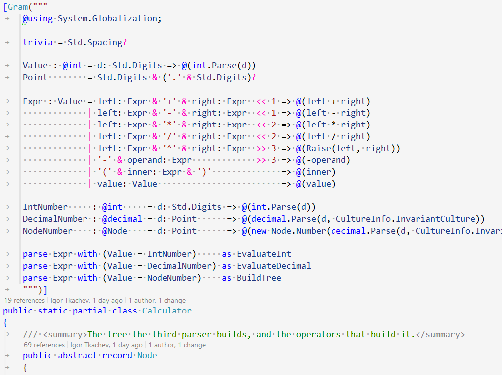

<!-- Agents: read src/DotGram/SKILL.md before writing a grammar (restored: ~/.nuget/packages/dotgram/<version>/SKILL.md);
     the other packages' skills are linked under "Writing grammars with a coding agent". -->

# .Gram

[](https://github.com/dotgram/dotgram/actions/workflows/build.yml)
[](https://dotgram.github.io/dotgram/)
[](https://www.nuget.org/packages/DotGram)
[](LICENSE)

**Fast, strongly typed C# parsers, generated from a grammar at compile time — no runtime library.**

You write the grammar; the build writes the parser into your own assembly as ordinary C#: typed results from
named captures, refusals that say what was expected and where, and nothing to deploy. One notation covers a
six-character colour code, a calculator, feeds written by people, and the SQL standard. On every accepted input in
the [tables below](#performance) the generated parser beats `Regex` and hand-written parsers of the same language.
.Gram is a source generator: the grammar lives in an attribute or a `.gram` file, and the compiler runs it.

**Documentation:** https://dotgram.github.io/dotgram/ — a guide to the language, a guide to the generator, every diagnostic, and the API reference.

## Writing grammars with a coding agent

A grammar is, in effect, a new language, and getting into one can look like a lot to learn before the first
parser works. With a coding agent the task is much simpler, and we made sure of that: every package ships a
`SKILL.md` written for coding agents — the notation, the generated API, what each diagnostic means, and the
mistakes agents tend to make. After a restore it is in the package folder
(`~/.nuget/packages/dotgram/<version>/SKILL.md`) and in this repository; `dotnet dotgram --skill` prints the CLI's.
Describe your format to the agent with two or three real samples and what you want back, point it at the skill,
and build: the generator's diagnostics (`GRAMnnnn`, pointing into the grammar) tell the agent what to fix.

Skills: [DotGram](src/DotGram/SKILL.md) · [DotGram.Cli](src/DotGram.Cli/SKILL.md) · [DotGram.Sql](src/DotGram.Sql/SKILL.md) ·
[DotGram.Web](src/DotGram.Web/SKILL.md) · [DotGram.Finance](src/DotGram.Finance/SKILL.md) · [DotGram.ExpressionLanguage](src/DotGram.ExpressionLanguage/SKILL.md).
How to hand one to an agent and what to check afterwards: [Writing grammars with a coding agent](https://dotgram.github.io/dotgram/agents.html);
the notation for people: the [language guide](https://dotgram.github.io/dotgram/guide/language/README.html).

## Install

```xml
<PackageReference Include="DotGram" Version="0.3.0" PrivateAssets="all" ExcludeAssets="runtime" />
```

.NET SDK 9.0.300+; any target from `netstandard2.0` up ([Compatibility](#compatibility)). A grammar lives in the
`[Gram]` attribute of the class the parser is generated into, as below, or in a `.gram` file listed as
`<AdditionalFiles Include="Name.gram" />`. Then [start here](https://dotgram.github.io/dotgram/#start-here): five
runnable examples, from a pattern instead of a regular expression to a stream of records.

## From a regex to the SQL standard

**Small.** A grammar the size of a regular expression stays that size:

```csharp
using DotGram;

[Gram("""
	Hex   = ['0'..'9' | 'a'..'f' | 'A'..'F']
	Color = '#' & value: Hex{6}

	parse Color
	""")]
public static partial class CssColor;
```

```csharp
var color = CssColor.ParseColor("#12aBcF");

Console.WriteLine(color.Value);                               // 12aBcF
Console.WriteLine(CssColor.TryParseColor("#xyz").IsSuccess);  // False
```

`value:` became a property of the generated result type; `TryParseColor` says what was expected, and where.

**A language.** A calculator is one rule. Precedence and associativity are written on the operators, and the
same grammar is published three times — over `int`, over `decimal`, and as a syntax tree:

```csharp
[Gram("""
	@using System.Globalization;

	trivia = Std.Spacing?

	Value : @int = d: Std.Digits => @(int.Parse(d))
	Point        = { Std.Digits ~ ('.' ~ Std.Digits)? }

	Expr : Value = left: Expr & '+' & right: Expr  << 1 => @(left + right)
	             | left: Expr & '-' & right: Expr  << 1 => @(left - right)
	             | left: Expr & '*' & right: Expr  << 2 => @(left * right)
	             | left: Expr & '/' & right: Expr  << 2 => @(left / right)
	             | left: Expr & '^' & right: Expr  >> 3 => @(Raise(left, right))
	             | '-' & operand: Expr             >> 3 => @(-operand)
	             | '(' & inner: Expr & ')'              => @(inner)
	             | value: Value                         => @(value)

	IntNumber     : @int     = d: Std.Digits => @(int.Parse(d))
	DecimalNumber : @decimal = d: Point      => @(decimal.Parse(d, CultureInfo.InvariantCulture))
	NodeNumber    : @Node    = d: Point      => @(new Node.Number(decimal.Parse(d, CultureInfo.InvariantCulture)))

	parse Expr with (Value = IntNumber)     as EvaluateInt
	parse Expr with (Value = DecimalNumber) as EvaluateDecimal
	parse Expr with (Value = NodeNumber)    as BuildTree
	""")]
public static partial class Calculator { /* Node, Raise and two options: CalculatorExample.cs */ }
```

```csharp
Calculator.EvaluateInt("7 / 2");        // 3
Calculator.EvaluateDecimal("7 / 2");    // 3.5
Calculator.EvaluateInt("2 ^ 3 ^ 2");    // 512: ^ groups to the right
Calculator.BuildTree("2 ^ 3 ^ 2");      // a Node tree for 2 ^ (3 ^ 2)
```

The whole file, tested: [`CalculatorExample.cs`](examples/DotGram.Examples/Expressions/CalculatorExample.cs); operator by
operator: [One grammar, three parsers](docs/tour.md#one-grammar-three-parsers).

**The SQL standard.** The same notation reads [T-SQL in over 1,000 rules](src/DotGram.Sql/TransactSql/TransactSql.gram),
one parser per SQL Server version from a single grammar, and [ISO SQL:2023](src/DotGram.Sql/Standard/SqlStandard.gram),
written from the standard's BNF. They ship ready to use in [`DotGram.Sql`](src/DotGram.Sql/README.md), and what they read of
SQL nobody here wrote is counted in [SQL conformance](docs/sql-conformance.md). More examples: [`examples/`](examples/README.md).

**Three ways in.** Your own language or format: a grammar, as above. Records from a `TextReader`, a bad line reported and
read past: [Feeds](docs/feeds.md). JSON, FIX, SQL, URIs: a [ready-made parser](#ready-made-parsers), and no grammar to write.

## Limits

- **A lexical grammar** (`Lexical = true`) reads text in memory: it has no reader or stream form.
- **Streaming where the generator proves it**: a `TextReader` overload only where the parse can let input go (`GRAM5001`); memory follows the longest record.
- **A large grammar costs build time** on every cold build; the CLI pays it once ([below](#big-grammars-fast-builds-fast-starts)).
- **When a `=>` runs depends on the carrier**: by default as it is read, readings given up included ([the contract](docs/syntax.md#what-a-construction-can-count-on)).
- **A generated parser limits nothing by default** — record size, nesting depth, time: see [Untrusted input](docs/untrusted-input.md).

## In Visual Studio



The [Visual Studio extension](https://marketplace.visualstudio.com/items?itemName=dotgram.dotgram) reads grammars in
`.gram` files and inside `[Gram]` strings: highlighting, errors as you type, Quick Info, completion, Go To Definition,
Find All References, Rename, folding. The languages you generate get the same: a string marked
`[StringSyntax("yourlanguage")]` is highlighted and checked as your language ([`docs/visual-studio.md`](docs/visual-studio.md)).

## Performance

"× faster" is the other side's time divided by .Gram's.

**Faster than `Regex`**, with both sides returning the same parts of every input, checked before timing:

| Input | .Gram | `Regex`, compiled | | `Regex` | |
| --- | ---: | ---: | ---: | ---: | ---: |
| `http://example.com` | 128 ns | 594 ns | **4.6×** | 1,516 ns | **12×** |
| `https://192.168.0.1/` | 158 ns | 585 ns | **3.7×** | 1,348 ns | **8.5×** |
| a URL with every part, 47 characters | 234 ns | 607 ns | **2.6×** | 1,443 ns | **6.2×** |
| a URL path of eight segments, 84 characters | 345 ns | 862 ns | **2.5×** | 2,925 ns | **8.5×** |
| an RFC 3339 timestamp | 59 ns | 449 ns | **7.6×** | 641 ns | **11×** |
| a FIX order message | 489 ns | 1,398 ns | **2.9×** | 1,962 ns | **4.0×** |

The timestamp pattern does not check the calendar, and the FIX pattern only splits `tag=value`: .Gram does more
work on those rows and is still faster.

**Faster than hand-written parsers** of the same language, held to the same answers on every input:

| What is parsed | .Gram | hand-written | |
| --- | ---: | ---: | ---: |
| a SQL `SELECT` of 20 columns | 5.4 µs | 11.6 µs | **2.1×** |
| a hand-kept stock count, 1,000 lines | 35 µs | 60 µs | **1.7×** |
| a FIX order message | 489 ns | 734 ns | **1.5×** |
| 128 FIX messages | 57 µs | 86 µs | **1.5×** |
| a URL with every part | 234 ns | 267 ns | **1.1×** |

Linux, AMD Ryzen 9 5950X, .NET 10; median of 5 runs, each in a fresh process, on an idle machine; commit
`c7cd493b0` (v0.3.0), [results](benchmarks/results/stand-2026-11-15-0.3.0.md).
The tables show accepted inputs. Refusing one can be slower than a compiled `Regex`, which gives up at the first
wrong character: a malformed URL takes 234 ns against 194 ns, a malformed timestamp 35 ns against 19 ns, while .Gram
also says where and what was expected. Every row we measure — every format, refusals, allocations, and the rows where
a hand-written parser is still ahead — is in [the results of v0.3.0](benchmarks/results/stand-2026-11-15-0.3.0.md);
how they are taken, in [`benchmarks/README.md`](benchmarks/README.md).

## Big grammars, fast builds, fast starts

<!-- STAND: generation time from the generator gate (G1) on the tag, DotGram.Sql per target framework
     (night 1, c831e00b: net10.0 13,368 ms, netstandard2.0 12,780 ms). -->
**Build time.** Generating the three SQL grammars of `DotGram.Sql` takes over ten seconds per target framework, most of it
`TransactSql.gram` (1,139 rules), and a cold build pays it every time. Keep a large grammar in a project of its own, so only the projects that change it pay;
or generate it once, commit the files, and the build compiles plain C# ([`docs/cli.md`](docs/cli.md): the CI check
that keeps them current; never the package and the files in one project, CS0102):

```shell
dotnet new tool-manifest
dotnet tool install DotGram.Cli
dotnet dotgram generate src/Grammars/Grammars.csproj -o src/Grammars/Generated
```

<!-- STAND: cold `dotnet build` of src/DotGram.Sql with the DotGram package against the same project compiling
     committed generated files (exclusive window, both target frameworks); not measured yet. Fill in: -->
<!-- A cold build of `DotGram.Sql` takes N s with the package and M s with the files committed. -->

<!-- STAND: first call JIT and ReadyToRun, exclusive run on the tag (directional so far: science perf-parsers-1110
     round 1, rows web/url.full, sql/select20, tsql/select-long; 5.9/36.5/70.7 ms JIT, 0.5/6.9/16.8 ms R2R). -->
**First call.** The first parse in a process waits for the JIT: about 6 ms for a URL, 37 ms for a 20-column SQL `SELECT`,
71 ms for a long T-SQL `SELECT`; the calls after it cost what the tables above show. Publish the application with
`<PublishReadyToRun>true</PublishReadyToRun>` and the first call drops to 0.5 ms, 6.9 ms and 17 ms. The price is
size on disk (`DotGram.Sql.dll` grows from 11.3 to 22.6 MB); the packages cannot ship precompiled code, because
such images are specific to a platform and a runtime version.

## More of the language

[Lexical mode](docs/guide/language/06-lexical.md) · [streaming](docs/tour.md#streaming-tokens-and-recovery) from a
`TextReader` · [recovery](docs/guide/language/13-recovery.md), so a bad record in a
<a name="feeds-written-by-people"></a>[feed written by people](docs/tour.md#feeds-written-by-people) is reported and
reading goes on · [versions of one language](docs/tour.md#versions-of-one-language) from one grammar ·
[typed parsing](docs/tour.md#typed-parsing) into your own types · [grammar libraries](docs/tour.md#grammar-libraries) ·
[why an input was refused](docs/tour.md#why-an-input-was-refused) · [the CLI for large grammars](docs/cli.md).
Every feature in one list: [the tour](docs/tour.md#what-a-grammar-can-do); what is not there yet: [`docs/status.md`](docs/status.md).

## Ready-made parsers

| Package | What it reads | |
| --- | --- | --- |
| [`DotGram.Sql`](src/DotGram.Sql/README.md) | T-SQL as SQL Server reads it, ISO SQL:2023 and SQL-92, into one tree, and back to text | [](https://www.nuget.org/packages/DotGram.Sql) |
| [`DotGram.Web`](src/DotGram.Web/README.md) | JSON, JSON Pointer and Patch, URIs and URI templates, media types, cookies, structured fields, e-mail addresses, timestamps, language tags — each after its RFC | [](https://www.nuget.org/packages/DotGram.Web) |
| [`DotGram.Finance`](src/DotGram.Finance/README.md) | FIX 4.2, 4.4 and 5.0 SP2 tag-value messages, from logs, archives, files and buses | [](https://www.nuget.org/packages/DotGram.Finance) |
| [`DotGram.ExpressionLanguage`](src/DotGram.ExpressionLanguage/README.md) | a C#-style expression language, straight into `System.Linq.Expressions` | [](https://www.nuget.org/packages/DotGram.ExpressionLanguage) |

## Compatibility

<a name="no-runtime-parser-library"></a>Builds with .NET SDK 9.0.300+ (Roslyn 4.14); the generated code is C# 8 for
any target from `netstandard2.0` up, with no runtime library of ours (`netstandard2.0` and `net472` reference `System.Memory`): everything a parser needs is generated into your
assembly as internal C#. Older targets in full: [`docs/compatibility.md`](docs/compatibility.md).

## License

[MIT](LICENSE). The code the generator writes into your compilation, and the files
`dotnet dotgram generate` writes, may be used under terms of your choice, without carrying
the notice: see [LICENSE-GENERATED-CODE](licenses/LICENSE-GENERATED-CODE).
Building and testing .Gram itself (`dotnet build DotGram.slnx`, `-c Linux` off Windows): [`docs/internal/development.md`](docs/internal/development.md).
